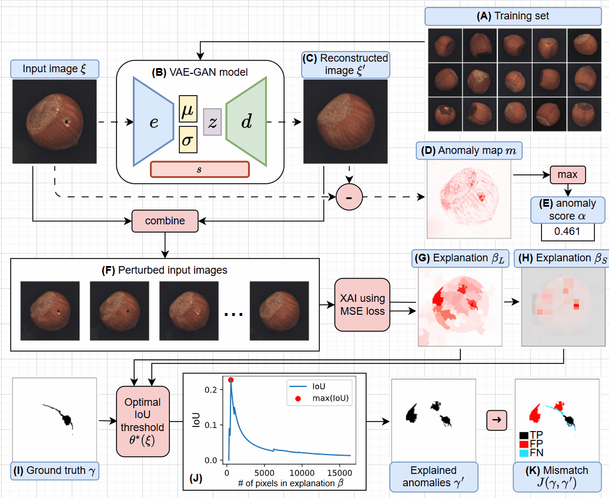

Can I Trust My Anomaly Detection System?
========================================

**A case study based on explainable AI.** Muhammad Rashid, Elvio Amparore,
Enrico Ferrari, Damiano Verda. *Explainable Artificial Intelligence* (xAI 2024),
Valletta, Malta. Springer CCIS, pp. 243–254.

`Paper <https://link.springer.com/chapter/10.1007/978-3-031-63803-9_13>`__ ·
`arXiv:2407.19951 <https://arxiv.org/abs/2407.19951>`__ ·
`Code <https://github.com/rashidrao-pk/anomaly_detection_trust_case_study>`__ ·
`Project page <https://rashidrao-pk.github.io/publication/p10_anomaly_detection_xai>`__

Generative models such as a VAE-GAN detect defects in industrial images by
reconstructing a part as if it were good and flagging large differences. A high
detection rate does not show *why* a part was flagged. This study explains the
anomaly score of a VAE-GAN with LIME and SHAP on the MVTec AD *hazelnut* and
*screw* categories, and measures with an optimal Jaccard index whether the
explanations land on the annotated defects. Many correctly flagged parts turn
out to be flagged for the wrong reason.

Start with the interactive demo, which replays the pipeline on the samples
discussed in the paper.

.. toctree::
   :caption: Demos
   :maxdepth: 1

   demos/trust/index

.. toctree::
   :caption: Guides
   :maxdepth: 1

   TENSORFLOW
   PAPER_FIGURES

Install
-------

.. code-block:: bash

   git clone https://github.com/rashidrao-pk/anomaly_detection_trust_case_study.git
   cd anomaly_detection_trust_case_study
   pip install -r requirements.txt          # TensorFlow 2.15, Python 3.9–3.11

The original 2024 notebooks and archived results are on the
`xai-2024-paper <https://github.com/rashidrao-pk/anomaly_detection_trust_case_study/tree/xai-2024-paper>`__
branch.

Citation
--------

.. code-block:: bibtex

   @InProceedings{10.1007/978-3-031-63803-9_13,
     author    = {Rashid, Muhammad and Amparore, Elvio and Ferrari, Enrico and Verda, Damiano},
     editor    = {Longo, Luca and Lapuschkin, Sebastian and Seifert, Christin},
     title     = {Can I Trust My Anomaly Detection System? A Case Study Based on Explainable AI},
     booktitle = {Explainable Artificial Intelligence},
     year      = {2024},
     publisher = {Springer Nature Switzerland},
     address   = {Cham},
     pages     = {243--254}
   }
